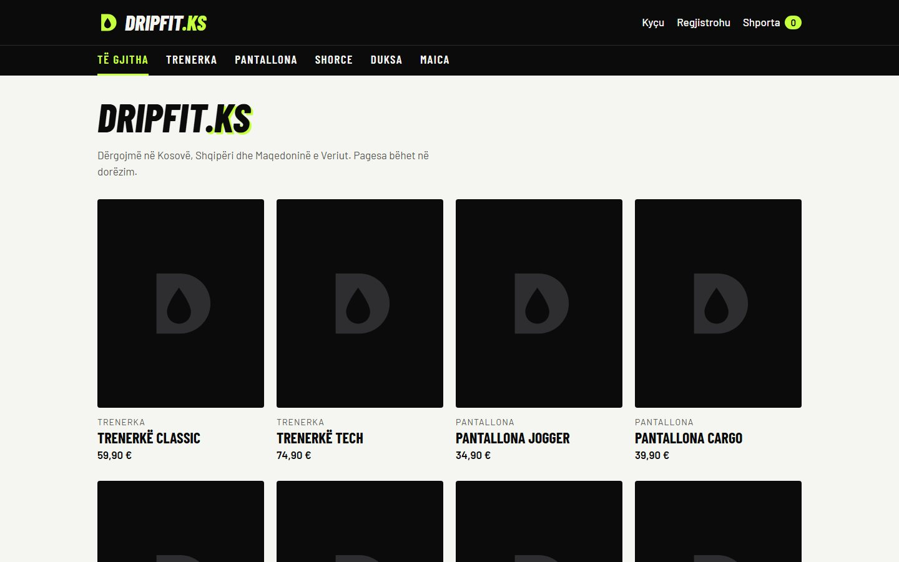

# 👕 DripFit.ks — Boutique de vêtements en ligne

Boutique en ligne de vêtements (survêtements, pantalons, shorts, sweats, t-shirts) développée en **PHP 8** avec une architecture **MVC maison** (sans framework) et une base de données **MySQL**.
Le site s'adresse à une clientèle du Kosovo, d'Albanie et de Macédoine du Nord : tous les textes du site sont en **albanais**.

> Projet réel en cours de développement pour un petit commerce. Les produits de la base d'exemple sont inventés.



---

## ✨ Fonctionnalités

**Côté client**
- Catalogue par catégorie et fiche produit
- Choix de la **taille** (XS → XXL) et de la **couleur** : chaque combinaison a son propre stock
- Panier (ajout, modification des quantités, suppression)
- Commande avec **paiement à la livraison** et choix du pays de livraison
- Vérification du stock au moment de la commande
- Compte client : inscription, connexion, historique des commandes

**Espace administrateur**
- Tableau de bord
- Gestion des produits et des photos
- Gestion des variantes (taille × couleur) et du stock
- Suivi des commandes et changement de statut (une commande annulée remet le stock)
- Email d'alerte à chaque nouvelle commande

---

## 🔒 Sécurité

- Requêtes préparées PDO partout (pas d'injection SQL)
- Échappement de tout ce qui est affiché (protection XSS)
- **Jeton CSRF** sur chaque formulaire POST
- Mots de passe hachés (`password_hash`), limitation des tentatives de connexion
- Commandes et stock gérés dans des **transactions** (pas de vente d'un article qui n'est plus en stock)
- En-têtes de sécurité HTTP, session sécurisée
- Photos envoyées : type vérifié, aucun script exécutable dans le dossier d'upload
- Réglages secrets (mot de passe de la base en ligne) dans un fichier ignoré par Git

---

## 🛠️ Technologies

| Côté | Outils |
|------|--------|
| Front-end | HTML5, CSS3 (variables CSS), JavaScript |
| Back-end | PHP 8, architecture MVC, PDO |
| Base de données | MySQL / MariaDB |
| Environnement | Laragon, Mailpit (emails en local), Git |

---

## 📁 Structure

```
dripfit.ks/
├── index.php          ← routeur (index.php?page=...), session, sécurité
├── config/            ← réglages du site et connexion à la base
├── controllers/       ← accueil, produits, panier, commande, comptes, admin
├── models/            ← Produit, Categorie, Commande, Utilisateur, Notification
├── views/             ← une vue par page + layout et admin
├── public/            ← CSS et photos des produits
└── database/          ← dripfit.sql (base + exemples), hebergement.sql (mise en ligne)
```

---

## 🚀 Installation en local

1. Cloner le projet dans le dossier `www` de **Laragon** :
   ```bash
   git clone https://github.com/selimidion70-png/dripfit.ks.git
   ```
2. Dans phpMyAdmin, importer `database/dripfit.sql` (crée la base avec des produits d'exemple)
3. Ouvrir **http://dripfit.ks.test** (ou `http://localhost/dripfit.ks/`)
4. Créer un compte sur le site, puis lui donner l'accès admin :
   ```sql
   UPDATE utilisateurs SET est_admin = 1 WHERE email = 'votre.email@exemple.com';
   ```

La mise en ligne chez un hébergeur est expliquée pas à pas dans [`MISE_EN_LIGNE.md`](MISE_EN_LIGNE.md).

---

## 👤 Auteur

**Dion Selimi** — développeur web front-end en formation à l'EFP Bruxelles

- Portfolio : [selimidion70-png.github.io](https://selimidion70-png.github.io)
- GitHub : [@selimidion70-png](https://github.com/selimidion70-png)
